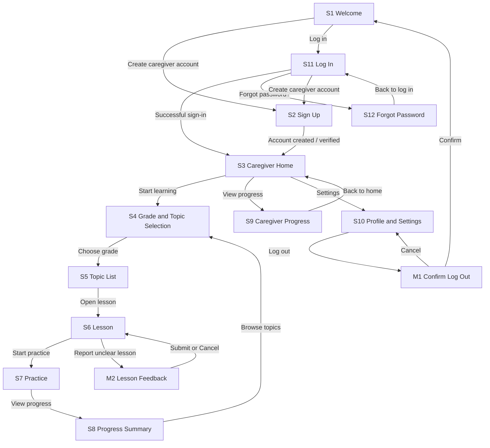

# IMPLEMENTATION_PLAN.md: MathsBridge

## 0. Plan details

| Field | Value |
| --- | --- |
| App name | MathsBridge |
| Built from PRD version | v0.5 (04 Nov 2026; Draft — pending facilitator approval) |
| Screen designs | [MathsBridge Stitch project](https://stitch.withgoogle.com/projects/2676201881162207322). Stitch drafts are not yet confirmed as final/exported; see Section 18. |
| Plan version | v0.2 (revised working draft) |
| Repository | Not created yet. GitHub username: Bao992; do not treat this as a repository URL. |
| Status | Draft — planning baseline updated; implementation remains gated by critical approvals and final design/privacy decisions |
| Last updated | 04 Nov 2026 |

---

## 1. Start here (instructions for the coding agent)

Before writing any code:

1. Read this whole file from top to bottom.
2. Read `docs/PRD.md`.
3. Look at the screen designs listed in Section 7.3.
4. Check Sections 18–19. Do not start implementation while any **Build-blocking** item remains unresolved. Items marked **Approval gate** must be closed before the affected release/pilot activity.
5. Check that the prerequisites in Section 4.2 are installed.
6. Start **Phase 1 only**. Follow Section 2 at all times.

---

## 2. Rules for the coding agent (copy word for word, do not edit)

1. **One phase at a time.** Only work on the phase the human asked for. When that phase's Definition of Done is complete, stop and wait for the human to say "Start Phase <number>".
2. **Test-driven development (TDD) for every task.** Follow the cycle in Section 12.1:
    - Write the test.
    - Run it and see it fail for the right reason.
    - Write the smallest code that makes it pass.
    - Run all tests.
    - Refactor while all tests still pass.
3. **Never cheat a test.** Never delete, skip, weaken or change a test just to make it pass. If you believe a test is wrong, stop and explain why to the human.
4. **Never break earlier work.** Every test from earlier phases must still pass before a phase is done.
5. **Build only what is planned.** Build only what is in this file and `docs/PRD.md`. Never build anything in Section 3.3 (Deferred). Treat the v0.5 decision register as authoritative where it supersedes v0.4.
6. **Ask, don't guess.** If anything is missing, unclear or contradictory, stop, add it to Section 18, and ask the human.
7. **Match the designs.** Every screen must match its design in Section 7.3: layout, order, labels, text, colours and spacing. Use the design tokens in Section 7.1. Never hard-code colours, font sizes or spacing.
8. **Every state, every screen.** Each screen must handle every state listed for it in Section 7.3 (chosen from normal, empty, loading, error, offline, success, plus any screen-specific states).
9. **Exact wording.** Use the exact labels and messages from the PRD. Never invent wording.
10. **Security first.**
    - Never put secret keys in app code, logs, test files or Git.
    - Every permission rule in Section 9 must be enforced on the server or database, never only in the app.
    - Every permission rule must have a test.
11. **Full check before "done".** Run the full check command (Section 4.3) before saying a phase is done, then add a short summary of the results to the Progress log (Section 17).
12. **Record your progress.** After each phase:
    - tick the checkboxes for that phase in this file;
    - add a row to the Progress log;
    - commit using the commit message given in the phase.
13. **No surprise libraries.** Do not add, remove or upgrade any library or tool not listed in Section 4.1 without asking the human first.
14. **Stuck rule.** If the same problem is still failing after 3 attempts, stop and report:
    - what you tried;
    - the exact error;
    - what you need from the human.
15. **Clean code.** Follow the folder structure in Section 5. Use the PRD's key terms (Section 3.4) for names in code. Keep files small and focused.

---

## 3. Project summary and scope

### 3.1 Summary

MathsBridge is a responsive browser-based Mathematics learning companion for Sepedi-speaking learners in Grades 4–7. V1 tests whether teacher-reviewed Sepedi explanations linked to English Mathematics terms, worked examples and short practice questions help learners understand selected CAPS-aligned topics. Caregivers manage learner access and can view a limited progress summary and published home activities. The app does not replace classroom teaching.

### 3.2 Features in scope

| Feature | Scope | Priority / evidence |
| --- | --- | --- |
| F1 — Caregiver account and access | Caregiver sign-up, email verification, log-in, password reset/session handling and caregiver-managed learner access described in PRD. | Must; US1, US2 |
| F2 — Grade and topic selection | Select Grades 4–7 and list only published topics in configured topic order. | Must; US3 |
| F3 — Reviewed lesson | Display reviewed Sepedi explanation, corresponding English Mathematics terms and worked example. | Must; US4 |
| F4 — Practice | Multiple-choice questions, answer submission, correctness and explanation feedback; save an immutable attempt. | Must; US5 |
| F5 — Learner progress | Topic-level attempt totals, correct totals, accuracy and rule-based practice status. | Must; US6 |
| F6 — Caregiver support | Caregiver sees progress and published home activities for an actively linked learner only. | Should as classified in PRD feature list; US7 |
| F7 — Lesson feedback | Learner can submit a fixed-category report about unclear lesson content, with optional note up to 300 characters. | Should as classified in PRD feature list; US8 |

**Feature priority note:** Priority is confirmed from PRD v0.5 Section 4.1 and retained in v0.5: F1–F5 are Must; F6–F7 are Should. Implement Must features first. Should features remain in the approved product scope but may follow the core learning loop.

### 3.3 Deferred: do NOT build

- Dedicated Android or iPhone apps; v1 is a responsive web app.
- Live classroom recording, automatic transcription or audio/video upload.
- AI-generated explanations, open chatbot or generative lesson content.
- Automatic import of a full syllabus or textbook; only the manually curated selected topic set is in scope.
- Teacher dashboard, teacher-managed groups, class management, class codes, grading system or school integration.
- Leaderboards, learner messaging, social features or push/email/SMS notifications (except authentication emails).
- Diagnosis of learning disabilities or intelligence; topic status is a practice indicator only.
- Offline lesson packs, additional home languages, reviewed audio explanations, teacher-approved uploaded notes.
- Any feature generated by Stitch that is not explicitly required by PRD v0.5.

### 3.4 Key terms (use these names in code)

| Term | Meaning |
| --- | --- |
| Topic | One CAPS-aligned Mathematics concept within a grade. |
| Lesson | Teacher-reviewed explanation and worked example for one topic. |
| Practice question | A question a learner answers to check understanding. |
| Attempt | One submitted answer, including result and submission time. |
| Progress summary | Topic-level view of attempts, accuracy and suggested next practice. |
| Caregiver | Parent/guardian linked to a learner with permission to view that learner's summary. |
| CaregiverLearner | Linking entity used to enforce caregiver access. |
| Topic status | Rule-based practice indicator; not a school mark or diagnosis. |

---

## 4. Tech stack, prerequisites and commands

### 4.1 Stack

| Layer | Choice | Notes |
| --- | --- | --- |
| Frontend | React 19 + Vite 7 | Confirm compatibility at setup; pin exact resolved versions. |
| Language | TypeScript 5.x | Pin installed version in lockfile. |
| Styling | Tailwind CSS 4 | Confirm Vite integration compatibility before setup. |
| Backend/API | Supabase JS v2 + PostgreSQL functions and policies | No separate Express API in v1. |
| Database | Supabase PostgreSQL | Migrations, constraints, indexes, RLS and trusted database functions. |
| Authentication | Supabase Auth | Email verification, password reset and sessions. |
| File storage | None | Text and SVG diagrams only; no child images, audio or classroom recordings. |
| Hosting | Vercel | Approved hosting direction; public demonstration URL required. Final production deployment remains gated by privacy and region review. |
| Package manager/runtime | npm 11.x, Node.js 24.x | Pin actual versions; do not silently change. |
| Testing | Vitest + React Testing Library; pgTAP; Playwright | Vitest/RTL for frontend, pgTAP for PostgreSQL/RLS, Playwright for browser journeys. |
| Version control | Git + GitHub | Repository not yet created. |

### 4.2 Prerequisites on the computer

- Node.js 24.x and npm 11.x installed; verify exact versions with `node --version` and `npm --version`.
- Git installed and configured; verify with `git --version`.
- VS Code or another IDE capable of TypeScript/React development.
- A Supabase project for development, with project URL and anon key available.
- Access to the MathsBridge Stitch project and final exported screen designs.
- A GitHub repository created for the project.
- A separate development Supabase project and fictional test accounts/data; never use real learner data in tests.

### 4.3 Commands

The exact scripts must be added to `package.json` in Phase 1 and then kept consistent with this section.

```bash
npm install
npm run dev
npm run lint
npm run typecheck
npm run test
npm run test:coverage
npm run build
```

Local workflow: install and pin a project-approved Supabase CLI version; run Supabase locally with Docker; manage schema changes as version-controlled SQL migrations; use pgTAP for database tests. Record the exact pinned CLI version and validated command syntax in the repository setup README when Phase 1 begins. Do not guess a version number before compatibility is checked.

**Full check:** `npm run lint && npm run typecheck && npm run test && npm run build`, plus the documented Supabase local reset and pgTAP suite. Playwright runs in the E2E/release check.

---

## 4.4 Approved development workflow and test tooling

| Area | Decision | Implementation note |
| --- | --- | --- |
| Local Supabase | Supabase CLI + Docker | Pin the CLI version in the repository setup documentation after validating the compatible release; do not leave an unpinned global dependency. |
| Schema changes | SQL migrations committed to Git | No undocumented manual schema changes in the hosted project. |
| Database tests | pgTAP | Cover constraints, trusted functions, business rules and RLS allow/deny cases. |
| Frontend tests | Vitest + React Testing Library | Component and frontend logic tests. |
| Browser E2E | Playwright | Full caregiver and learner journeys, including access denial after unlink. |
| Deployment | Vercel frontend + hosted Supabase | Public demo URL required; production/real-child pilot remains subject to privacy approval. |

## 4.5 Approved learner access and pairing decisions

- Caregiver signs in and selects **Add Learner**.
- Caregiver enters learner name and grade; MathsBridge creates the learner profile and one-time pairing code.
- Learner opens MathsBridge on their device and enters the code. The code is single-use and expires after 24 hours.
- On first successful pairing, learner creates a 4-digit PIN. Later visits select their profile and enter the PIN.
- Caregiver can reset the learner PIN. The learner session can access only that learner's records.
- PINs must be stored using an appropriate one-way password-hashing approach; never store a plain-text PIN. Add server-side attempt limits and temporary blocking. Exact thresholds and implementation details must be specified and tested before release.
- Pairing code: 8-character random alphanumeric code excluding easily confused characters (O/0/I/1), generated with a cryptographically secure random generator, stored as a hash, single-use, and invalidated immediately after successful use. Failed-attempt thresholds require security specification; do not invent a numeric threshold.
- Caregiver unlink requires confirmation and immediately revokes access while preserving learner history. Pairing/unlink visual layout and exact labels must follow final approved designs.

## 4.6 Database entities, indexes and query patterns

Retain the nine PRD entities: Caregiver, Learner, CaregiverLearner, Topic, Lesson, PracticeQuestion, Attempt, HomeActivity and LessonFeedback. Do not add an entity merely to represent learner PIN/session functionality; incorporate secure learner authentication/session attributes into the existing learner/access design, subject to schema review. Preserve every field, nullability, limit, default, relationship and delete rule from PRD 10.1–10.2.

Baseline index candidates approved for implementation:

- Foreign-key columns used by joins and RLS checks.
- CaregiverLearner lookups by caregiver, learner and active link state.
- Topic listing by grade, publication status and topic order; retain unique positive topic order within grade.
- Attempt retrieval/aggregation by learner, question and submission time, supporting topic-level progress queries.

Additional indexes may be added when the query pattern and reason are documented and performance evidence or a clear access path justifies them. Validate redundant indexes and write overhead; do not create duplicate indexes blindly.

## 4.7 Hosting, privacy and content-review gates

- Vercel is the approved frontend hosting direction; a public demonstration URL is required.
- Supabase region is not selected. Region choice and final Privacy Notice, retention and deletion wording require facilitator and appropriate privacy/legal review before production or real-child pilot.
- Minimise child data; caregiver consent is required before learner profile creation. No learner photos, precise location, audio or classroom recordings in v1. Use fictional data in development/demo.
- Each lesson requires both a fluent Sepedi-language review and a Mathematics educator review before an authorised content administrator publishes it. Reviewer identities are not yet confirmed.
- Stitch designs are **Draft — Pending Approval**. Do not lock design tokens or claim screen/design sign-off until final exports and contrast checks are approved.

---

## 5. Folder structure

```text
mathsbridge/
├── docs/
│   ├── PRD.md
│   └── designs/                 # final exported Stitch screen images, one per S#/M#
├── IMPLEMENTATION_PLAN.md
├── src/
│   ├── app/                     # app shell, routes, session/learner context
│   ├── components/              # shared components
│   ├── pages/                   # S1–S12 screen components
│   ├── features/
│   │   ├── auth/                # caregiver sign-up, log-in, reset
│   │   ├── learning/             # grades, topics, lessons, practice
│   │   ├── progress/             # progress calculations and views
│   │   ├── caregiver/            # linked learner and caregiver view
│   │   └── feedback/             # lesson feedback
│   ├── lib/supabase.ts
│   ├── types/
│   └── styles/                  # design tokens and global styles
├── supabase/
│   ├── migrations/
│   └── seed.sql
├── tests/
│   ├── unit/
│   ├── components/
│   ├── database/                 # pgTAP and database integration
│   ├── integration/
│   └── e2e/                     # Playwright
├── .env.example
├── .gitignore
├── package.json
└── package-lock.json
```

---

## 6. Environment variables and secrets

| Name | Purpose | Classification | Where used |
| --- | --- | --- | --- |
| `VITE_SUPABASE_URL` | Supabase project URL | Public | Browser Supabase client |
| `VITE_SUPABASE_ANON_KEY` | Supabase anon/browser key | Public only with correctly enabled and tested RLS | Browser Supabase client |
| `SUPABASE_SERVICE_ROLE_KEY` | Privileged trusted scripts only; not needed in browser | Secret | Local trusted scripts/administrative tasks only; never frontend, logs or Git |

- Real values belong in ignored `.env` / local environment configuration.
- Commit `.env.example` with placeholder values only.
- Verify `.env*` ignore rules while explicitly allowing `.env.example`.
- Do not expose service-role key in any `VITE_` variable, browser bundle, test fixture, screenshot or Git history.
- Rotate any key accidentally committed or exposed.

---

## 7. Design system and screens

### 7.1 Design tokens

PRD 9.1 and the Stitch project are the source for actual visual tokens. The values must be extracted from the final designs; do not invent hex colours, fonts, sizes or radii. The following token names are the implementation contract, with values marked **TODO** until the design review confirms them.

| Token | Value | From PRD/design |
| --- | --- | --- |
| `color.primary` | TODO — extract exact value | PRD 9.1 / final Stitch design |
| `color.background` | TODO | PRD 9.1 / final Stitch design |
| `color.text` | TODO | PRD 9.1 / final Stitch design |
| `color.error`, `color.success`, `color.warning` | TODO | PRD 9.1 / final Stitch design |
| `font.family` | TODO | PRD 9.1 / final Stitch design |
| `font.size.*` | TODO | PRD 9.1 / final Stitch design |
| `space.*` | TODO | PRD 9.1 / final Stitch design |
| `radius.*` | TODO | PRD 9.1 / final Stitch design |
| `size.button`, `size.touchMin` | TODO; PRD accessibility requires minimum touch target 44 px | PRD 9.1 and 9.4 |

Do not mark design matching complete until the actual values and contrast ratios are verified.

### 7.2 Shared components

| Component | File | Variants and states | Used on | Tests |
| --- | --- | --- | --- | --- |
| Button | `src/components/Button.tsx` | Primary/secondary, disabled/loading | All applicable screens | T-C-1 |
| TextField | `src/components/TextField.tsx` | Default, focused, invalid, disabled | S2, S11, S12, S10 | T-C-2 |
| Checkbox | `src/components/Checkbox.tsx` | Checked/unchecked/disabled | S2, S10 | T-C-3 |
| AppHeader | `src/components/AppHeader.tsx` | Logged-in header and title | S3–S10 | T-C-4 |
| LearnerCard | `src/components/LearnerCard.tsx` | Normal/loading/empty | S3, S9 | T-C-5 |
| GradeCard | `src/components/GradeCard.tsx` | Grades 4–7, selected | S4 | T-C-6 |
| TopicCard | `src/components/TopicCard.tsx` | Published topic and progress/status variant where specified | S5, S8, S9 | T-C-7 |
| LessonContent | `src/components/LessonContent.tsx` | Sepedi text, English term pairs, worked example | S6 | T-C-8 |
| QuestionOption | `src/components/QuestionOption.tsx` | Unselected/selected/feedback | S7 | T-C-9 |
| ProgressSummary | `src/components/ProgressSummary.tsx` | Topic totals, accuracy and status; empty | S8, S9 | T-C-10 |
| FeedbackModal | `src/components/FeedbackModal.tsx` | Category selection, optional note, validation, submitting/success | M2 | T-M2-1 |
| ConfirmLogoutModal | `src/components/ConfirmLogoutModal.tsx` | Confirm/cancel | M1 | T-M1-1 |
| OfflineBanner | `src/components/OfflineBanner.tsx` | Visible/hidden | Screens requiring network | T-C-11 |

Only implement components actually supported by PRD and approved designs. If a component's exact visual treatment is absent, ask rather than invent.

### 7.3 Screens

**Design source for every row:** the Stitch project URL in Section 0. The project is currently described by PRD v0.5 as design drafts; individual final export filenames and visual sign-off are not yet available. Export each named screen/modal to `docs/designs/` and replace the design description with the exact filename before Phase 1 is approved. No admin screens exist in v1.

| ID | Screen | Route / file | Design | Who can open it (else redirect to) | Tab bar | Required states | Phase |
| --- | --- | --- | --- | --- | --- | --- | --- |
| S1 | Welcome | `/` — `pages/WelcomePage.tsx` | Stitch S1; export required | Logged out; signed-in caregiver → S3 | No | Normal, startup error, offline banner, route success | 1 |
| S2 | Sign Up | `/sign-up` — `pages/SignUpPage.tsx` | Stitch S2; export required | Logged out; signed-in caregiver → S3 | No | Normal, validation errors, loading, server error, offline, success verification notice | 4 |
| S3 | Caregiver Home | `/home` — `pages/CaregiverHomePage.tsx` | Stitch S3; export required | Verified signed-in caregiver; otherwise S1/S11 | No | Normal, empty learners, loading skeleton, error, offline, learner-created success | 4/6 |
| S4 | Grade and Topic Selection | `/learn/grades` — `pages/GradeSelectionPage.tsx` | Stitch S4; export required | Signed-in caregiver with selected active learner; otherwise S3 | No | Normal, loading, error, offline | 5 |
| S5 | Topic List | `/learn/grades/:grade/topics` — `pages/TopicListPage.tsx` | Stitch S5; export required | Valid selected learner and grade; otherwise S3/S4 | No | Normal, no published topics, loading, error, offline | 5 |
| S6 | Lesson | `/learn/topics/:topicId` — `pages/LessonPage.tsx` | Stitch S6; export required | Active learner context and published lesson; otherwise S3/S5 | No | Normal, loading, load error with Retry, offline | 6 |
| S7 | Practice | `/learn/topics/:topicId/practice` — `pages/PracticePage.tsx` | Stitch S7; export required | Active learner context and published questions; otherwise S6 | No | Question, selected option, validation error, submitting, correct/incorrect feedback, next question, completion | 6 |
| S8 | Progress Summary | `/learn/progress` — `pages/ProgressPage.tsx` | Stitch S8; export required | Active learner context; otherwise S3 | No | Normal with attempts, no attempts, loading, error, offline | 7 |
| S9 | Caregiver Progress | `/caregiver/learners/:learnerId` — `pages/CaregiverProgressPage.tsx` | Stitch S9; export required | Active linked caregiver only; otherwise S3 with exact access message | No | Normal, loading, error, offline, unlinked/access denied | 8 |
| S10 | Profile and Settings | `/settings` — `pages/SettingsPage.tsx` | Stitch S10; export required | Signed-in caregiver; otherwise S1/S11 | No | Normal, loading, form errors, save success, offline | 4/8 |
| S11 | Log In | `/login` — `pages/LogInPage.tsx` | Stitch S11; export required | Logged out; signed-in caregiver → S3 | No | Normal, validation, loading, invalid credentials, offline, success | 4 |
| S12 | Forgot Password | `/forgot-password` — `pages/ForgotPasswordPage.tsx` | Stitch S12; export required | Logged out; signed-in caregiver → S3 | No | Normal, validation, loading, generic success confirmation, error, offline | 4 |
| M1 | Confirm Log Out | Modal on S10 | Stitch M1; export required | Signed-in caregiver on S10; otherwise unavailable | No | Open, confirm/loading, cancel, success to S1 | 4 |
| M2 | Lesson Feedback | Modal on S6 | Stitch M2; export required | Active learner context on S6; otherwise unavailable | No | Open, category selection, optional note, validation, submitting, success, error | 9 |

**Add Learner flow:** The caregiver-created profile and one-time pairing journey is approved in PRD v0.5 Section C and this plan Section 4.5. The exact screen/modal design remains unapproved; implement only after final Stitch exports or an explicitly approved design specification are available.

---

## 8. Data model and database

### 8.1 Tables

The names below use the PRD's entity names. Preserve the PRD's exact field definitions, nullability, limits, default values and relationships in migrations. The complete field-level schema is in `docs/PRD.md` Section 10.1; this plan must not silently simplify it.

| Table | Purpose | Key fields / constraints to implement from PRD 10.1 |
| --- | --- | --- |
| Caregiver | Caregiver profile linked to Supabase Auth | PRD fields; auth owner only; auth ID immutable |
| Learner | Learner display profile and grade/status | PRD fields; only permitted profile fields mutable; no public access |
| CaregiverLearner | Caregiver-to-learner access link and pairing state | PRD fields; valid/unused/unexpired pairing; active/unlinked/expired states |
| Topic | Grade/topic catalogue and publication status/order | Grades 4–7; published topics only visible to app users |
| Lesson | Reviewed Sepedi explanation, English terms and worked example | Draft/published/archived; publish only after content review |
| PracticeQuestion | Multiple-choice question, options, correct answer and explanation | 2–4 options; published only for published lessons; answer correctness never trusted from browser |
| Attempt | Submitted answer, correctness and timestamp | Immutable; correctness calculated by trusted database logic |
| HomeActivity | Caregiver-facing home activity per topic | At most one per topic in v1; published only visible |
| LessonFeedback | Learner report of unclear content | Fixed category; optional note max 300 chars; project-owner only read |

**Important:** use the exact column names and types from PRD 10.1, not inferred names. The plan's reference to `docs/PRD.md` is authoritative for the complete schema.

### 8.2 Relationships and delete behaviour

- One Caregiver has many CaregiverLearner links.
- One Learner may have multiple caregiver links only when explicitly created.
- One Learner has many Attempts and LessonFeedback records.
- One Topic has one or more Lessons and at most one HomeActivity in v1.
- One Lesson has many PracticeQuestions and LessonFeedback records.
- One PracticeQuestion has many Attempts.
- CaregiverLearner is the access-control link for learner-specific data.
- Apply PRD 10.1 deletion behaviour and PRD 12.4 retention: do not cascade/delete records differently from the approved retention workflow. Learner deletion must use a trusted deletion workflow.

### 8.3 Status changes

| Entity.field | From | To | Cause |
| --- | --- | --- | --- |
| Learner.status | Active | Archived | Caregiver action or project-owner maintenance |
| CaregiverLearner.status | Active | Unlinked | Caregiver confirms unlink; access removed immediately (BR8) |
| CaregiverLearner.status | Active | Expired | Pairing code expires after 24 hours unused (BR8) |
| Topic.status | Draft | Published | Content administrator after BR1–BR3 checks |
| Topic.status | Published | Archived | Content administrator; no longer listed |
| Lesson.status | Draft | Published | Content administrator after review (BR3) |
| Lesson.status | Published | Archived | Content administrator |
| PracticeQuestion.status | Draft | Published | Content administrator after BR4 checks |
| HomeActivity.status | Draft | Published | Content administrator after review |
| LessonFeedback | Created | Reviewed | Project owner marks reviewed in dashboard |

### 8.4 Indexes

The product owner approved the baseline index approach in Section 4.6: foreign keys used by joins/RLS, caregiver–learner lookups, Topic grade/status/order and Attempt learner/question/submission-time query paths. Additional indexes may be added with documented query justification and performance evidence; avoid redundant indexes and account for write overhead.

### 8.5 Automatic jobs and triggers

- No scheduled jobs in v1.
- Pairing-code expiry is checked when a code is used; 24-hour unused codes transition to Expired (BR8).
- Attempt correctness and progress-relevant values must be calculated by trusted database logic.
- Abuse limits must be enforced server-side: max 20 answer submissions per learner per 10 minutes; max 5 feedback reports per learner per day.
- Exact function/trigger names and transaction design require confirmation where not specified in PRD; do not invent external scheduled services.

### 8.6 Migrations (in order)

1. Enable required PostgreSQL extensions only if needed and approved.
2. Create core caregiver/learner/link and content tables using exact PRD schema.
3. Add constraints, foreign keys, uniqueness and the approved baseline indexes in Section 4.6; document any additional index rationale.
4. Enable RLS on every app-accessible table.
5. Add policies for caregiver ownership, active learner links, published-only content and feedback privacy.
6. Add trusted attempt-submission and learner-pairing functions with server-side validation and rate limits.
7. Add seed records from PRD 8.4.
8. Add database tests for every constraint, business rule and permission.

### 8.7 Seed data and test accounts

Use only fictional sample records from PRD 8.4. The PRD names `caregiver.demo@example.test` as a development test account; its password must be generated locally and never committed. Seed at least two topics per grade and three questions per topic before the full MVP demo, as required by PRD 10.4. Do not use real children's names, emails or progress data in automated tests or demo fixtures.

---

## 9. Security and permissions

Every table must have RLS enabled where browser access is possible. Enforce all rules in PostgreSQL policies/functions, not merely React route guards. Each row below requires both an allow and deny test.

| ID | Table / resource | Action | Who is allowed | Rule | Enforced by | Tests (allow / deny) |
| --- | --- | --- | --- | --- | --- | --- |
| SEC1 | Caregiver | Read/update | Owner only | Cannot change auth ID | RLS + constrained update | T-SEC-1a / T-SEC-1b |
| SEC2 | Learner | Read | Active linked caregiver / authorised learner session | No public access; only linked learner data | RLS | T-SEC-2a / T-SEC-2b |
| SEC3 | Learner | Create/update | Authenticated caregiver with active link | Only permitted profile fields | RLS + validation | T-SEC-3a / T-SEC-3b |
| SEC4 | Learner | Delete | Trusted deletion workflow | Apply approved retention rule | Restricted function | T-SEC-4a / T-SEC-4b |
| SEC5 | CaregiverLearner | Read | Linked caregiver | Own links only | RLS | T-SEC-5a / T-SEC-5b |
| SEC6 | CaregiverLearner | Create | Authenticated caregiver | Code valid, unused and unexpired | Trusted database function | T-SEC-6a / T-SEC-6b |
| SEC7 | CaregiverLearner | Update | Linked caregiver | Only unlink action | RLS + function | T-SEC-7a / T-SEC-7b |
| SEC8 | Topic | Read | Authenticated users | Published only | RLS | T-SEC-8a / T-SEC-8b |
| SEC9 | Topic | Write/delete | Project owner via Supabase dashboard | No client writes | Dashboard role; deny app clients | T-SEC-9a / T-SEC-9b |
| SEC10 | Lesson | Read | Authenticated users | Published only | RLS | T-SEC-10a / T-SEC-10b |
| SEC11 | Lesson | Write/delete | Project owner via dashboard | No client writes | Dashboard role; deny app clients | T-SEC-11a / T-SEC-11b |
| SEC12 | PracticeQuestion | Read | Authenticated users | Published questions for published lessons | RLS | T-SEC-12a / T-SEC-12b |
| SEC13 | PracticeQuestion | Write/delete | Project owner via dashboard | No client writes | Dashboard role; deny app clients | T-SEC-13a / T-SEC-13b |
| SEC14 | Attempt | Read | Active linked caregiver/learner session | Only linked learner's records | RLS | T-SEC-14a / T-SEC-14b |
| SEC15 | Attempt | Create | Trusted database function | Validate question and calculate correctness server-side | RPC/function | T-SEC-15a / T-SEC-15b |
| SEC16 | Attempt | Update/delete | No app user | Immutable after submission | RLS deny | T-SEC-16a / T-SEC-16b |
| SEC17 | HomeActivity | Read | Authenticated caregiver | Published only | RLS | T-SEC-17a / T-SEC-17b |
| SEC18 | HomeActivity | Write/delete | Project owner via dashboard | No client writes | Dashboard role; deny app clients | T-SEC-18a / T-SEC-18b |
| SEC19 | LessonFeedback | Create | Active learner context | Fixed category; note ≤300 chars; max 5/day | RPC/RLS/constraint | T-SEC-19a / T-SEC-19b |
| SEC20 | LessonFeedback | Read/update/delete | Project owner only | Not browsable by learner/caregiver | RLS | T-SEC-20a / T-SEC-20b |

**Always-on security checks**

- [ ] RLS is enabled on every app-accessible table; automated test fails if any table is missing RLS.
- [ ] Inputs are validated in UI and again in trusted database functions/constraints.
- [ ] Answer rate limit (20 per learner per 10 minutes) and feedback limit (5 per learner per day) are enforced server-side.
- [ ] No passwords, tokens, secret keys or unnecessary personal data are logged.
- [ ] Secret scan confirms no keys in repository or Git history.
- [ ] Cross-caregiver and unlinked-caregiver access is denied at the database layer.
- [ ] Attempt correctness cannot be supplied or modified by browser client.

---

## 10. Backend operations

The PRD uses Supabase client operations and trusted PostgreSQL functions; no standalone Express API is in scope.

| ID | Operation | Who can call it | Input | Output | Rules | Errors (exact message) | Built as | Tests |
| --- | --- | --- | --- | --- | --- | --- | --- | --- |
| OP1 | Create caregiver account | Logged-out visitor | Full name, email, password, adult/guardian confirmation, Privacy Notice consent | Verification notice | F1, auth rules | “We couldn’t create your account. Check your details or try signing in.” / success “Check your email to verify your account.” | Supabase Auth + caregiver profile | T-US1-1, T-US1-2 |
| OP2 | Sign in | Logged-out visitor | Email/password | Session | Verified caregiver only | “Email or password is incorrect.” | Supabase Auth | T-US2-1, T-US2-2 |
| OP3 | Password reset | Logged-out caregiver | Email | Generic reset confirmation | Avoid account enumeration | Exact final message must be confirmed in PRD screen specification | Supabase Auth | T-AUTH-1 |
| OP4 | Load caregiver learners | Signed-in caregiver | Auth session | Own linked learner cards | SEC1–SEC5 | “We couldn’t load your learners. Try again.” | Supabase query + RLS | T-SEC-2a/b, T-INT-1 |
| OP5 | Pair/add learner | Signed-in caregiver | Pairing details/code as clarified | Linked learner | BR8; code valid, unused, unexpired | Exact UX/messages unresolved | Trusted DB function | T-SEC-6a/b, T-BR8-1 |
| OP6 | Load published topics | Authenticated user with learner context | Grade | Ordered published topics | BR1–BR3; SEC8 | “No lessons are available for this grade yet.” | Supabase query + RLS | T-US3-1, T-US3-2 |
| OP7 | Load lesson | Active learner context | Topic ID | Published lesson, terms and example | BR1–BR3; SEC10 | “This lesson couldn’t load. Check your connection and try again.” | Supabase query + RLS | T-US4-1, T-US4-2 |
| OP8 | Load practice question | Active learner context | Lesson/topic and question position | One published question and options | BR4; SEC12 | Generic error “Something went wrong. Try again.” where applicable | Supabase query | T-BR4-1, T-INT-2 |
| OP9 | Submit answer | Active learner context | Question ID, selected option | Trusted correctness and explanation; immutable attempt | BR4, rate limit; SEC15–SEC16 | Validation “Choose an answer before continuing.”; generic server error | Trusted PostgreSQL function/RPC | T-US5-1, T-US5-2, T-BR4-1 |
| OP10 | Load learner progress | Active learner context | Learner ID | Topic attempt totals, correct totals, accuracy, status | BR6–BR7; SEC14 | “Your progress will appear after you answer practice questions.” | Trusted query/view/function + RLS | T-US6-1, T-US6-2 |
| OP11 | Load caregiver progress/activity | Active linked caregiver | Learner ID | Topic statuses and published home activities | BR8; SEC2, SEC14, SEC17 | “You no longer have access to this learner.” | Supabase query + RLS | T-US7-1, T-US7-2 |
| OP12 | Submit lesson feedback | Active learner context | Category, optional note ≤300 chars | Created feedback record | BR10; max 5/day; SEC19 | “Keep your note to 300 characters or fewer.” / “Thanks. Your feedback has been recorded.” | Trusted DB function/insert with RLS | T-US8-1, T-US8-2 |
| OP13 | Unlink learner | Linked caregiver | Learner link ID and confirmation | Link status Unlinked; access revoked immediately | BR8; SEC7 | Exact confirmation/error copy from PRD must be retained | Restricted update/function | T-BR8-2, T-SEC-7a/b |
| OP14 | Log out | Signed-in caregiver | Current session | Session cleared | M1 | No extra message specified | Supabase Auth signOut | T-M1-1 |

Implement OP5/OP13 only against the caregiver-created profile and pairing journey in PRD v0.5. The pairing screen/modal layout and final visual states remain gated by approved Stitch exports; do not invent visual details.

---

## 11. Navigation rules

- **Logged out:** S1, S2, S11 and S12 are available. Protected routes redirect to S1 or S11 as specified by the PRD.
- **Signed in but email unverified:** do not grant learner access; show the verification state defined by the approved auth flow. Exact route/state requires clarification.
- **Verified and signed in:** default to S3. Opening logged-out screens routes to S3.
- **Learner context:** S4–S8 require a selected, active learner context and an authenticated session; if missing, route to S3.
- **Caregiver context:** S9 requires an active caregiver–learner link; if link is removed, show “You no longer have access to this learner.” and return to S3.
- **Settings:** S10 is signed-in caregiver only. M1 opens from S10; confirm returns to S1 after sign-out, cancel returns to S10.
- **Feedback:** M2 opens from S6 and returns to S6 on submit or cancel.
- **Tabs:** PRD does not define a tab bar; do not add one.
- **Back button:** follow the source screen flow; modal back/escape closes only when safe. Confirm exact browser-history behaviour in Section 18 if the designs do not show it.



---

## 12. Testing strategy

### 12.1 The TDD cycle (every task, every phase)

1. **Red:** write one test for the behaviour, using the acceptance criterion or rule. Run it. It must **fail**, and fail for the expected reason (e.g. "screen not found", not "syntax error").
2. **Green:** write the **smallest** amount of code that makes that test pass. Run **all** tests.
3. **Refactor:** clean up names, remove duplication, move code to the right folder. Run all tests again. They must still pass.
4. Repeat for the next test.

### 12.2 Test levels

| Level | What it proves | Tool | Folder | Command |
| --- | --- | --- | --- | --- |
| Unit | BR calculations and validation helpers | Vitest | `tests/unit/` | `npm run test -- tests/unit` |
| Component | Screen/component content and states with fake data | Vitest + React Testing Library | `tests/components/` | `npm run test -- tests/components` |
| Database and permissions | Constraints, functions, RLS allow/deny | Supabase CLI + Docker + pgTAP | `tests/database/` | Document pinned CLI and pgTAP commands in setup README |
| Integration | Supabase operations against development/local DB | Vitest and approved Supabase test setup | `tests/integration/` | `npm run test -- tests/integration` |
| End-to-end | Full caregiver-to-learner flows in browser | Playwright | `tests/e2e/` | `npx playwright test` (script to be added to package.json) |
| Manual | Design comparison, keyboard and real-device acceptance | Human | Phase manual checks | — |

### 12.3 Test IDs

Every automated test title starts with its ID. Use PRD acceptance IDs exactly: `T-US1-1` through `T-US8-2`. Also use:

| Prefix | Comes from | Example |
| --- | --- | --- |
| T-SETUP-# | Phase 1 tooling | T-SETUP-1 |
| T-US#-# | PRD Section 6 | T-US3-1 |
| T-AUTH-# | Account rules | T-AUTH-1 |
| T-BR#-# | PRD Section 4.4 | T-BR6-1 |
| T-SEC-#a / b | Permission rules | T-SEC-2a / T-SEC-2b |
| T-DB-# | Database constraints | T-DB-1 |
| T-INT-# | Backend operations | T-INT-1 |
| T-C-# | Shared components | T-C-1 |
| T-S#-# / T-M#-# | Screen/modal states | T-S3-1 / T-M2-1 |
| T-NAV-# | Navigation | T-NAV-1 |
| T-EDGE-# | PRD edge cases | T-EDGE-1 |
| T-E2E-# | Full user flows | T-E2E-1 |
| T-NFR-# | Quality requirements | T-NFR-1 |
| T-REL-# | Release | T-REL-1 |

Do not invent missing T-US IDs. Map BR1–BR11 and each of the seven source-defined edge cases to explicit test IDs before implementation of the affected rule.

### 12.4 Test data rules

- Tests are independent and order-independent.
- Database tests start from a clean migration reset and fictional seed data.
- Component tests use fictional sample data from PRD 8.4; no live network calls.
- Never use real learner/caregiver personal data or real passwords in tests.
- Use separate caregiver accounts in permission tests to prove cross-account isolation.

### 12.5 Coverage rules

- 100% of PRD acceptance criteria have automated tests, or a documented manual test where automation is not possible.
- 100% of BR1–BR11 have unit/database tests.
- 100% of Section 9 permission rows have allow and deny tests.
- 100% of PRD Section 6.2 edge cases have tests.
- Minimum 80% line coverage for business-rule code (template baseline; confirm against PRD/course requirement).
- Every phase runs the complete test suite and type/lint/build checks.

---

## 13. Phases

### 13.0 Phase overview

| Phase | Name | Features | Screens | Main tests |
| --- | --- | --- | --- | --- |
| 1 | Foundation | — | S1 | T-SETUP-1, T-C-1, T-S1-1 |
| 2 | Data and security | — | — | T-DB-*, T-SEC-*, T-BR* |
| 3 | Caregiver authentication and profile shell | F1 | S1, S2, S3, S10, S11, S12, M1 | T-US1-*, T-US2-*, T-AUTH-*, T-NAV-* |
| 4 | Grade and topic discovery | F2 | S4, S5 | T-US3-*, T-BR1-* |
| 5 | Lessons and practice | F3, F4 | S6, S7 | T-US4-*, T-US5-*, T-BR4-* |
| 6 | Learner progress | F5 | S8 | T-US6-*, T-BR6-*, T-BR7-* |
| 7 | Caregiver support | F6 | S9 | T-US7-*, T-BR8-*, T-SEC-* |
| 8 | Lesson feedback | F7 | M2 | T-US8-*, T-BR10-* |
| 9 | Hardening | — | All | T-EDGE-*, T-NFR-*, T-E2E-*, all security tests |
| 10 | Release | — | All | T-REL-*, full suite |

### Phase 1: Foundation

**Goal:** A clean React/TypeScript app runs locally, has repeatable tooling and one tested screen that follows the approved design tokens.

**Covers:** No feature delivery · S1 shell · shared components · T-SETUP and T-C

**Starts when:** Facilitator has reviewed the PRD v0.5 baseline; build-blocking requirements in Section 18 are resolved for the phase; required design exports are approved; and the human says "Start Phase 1". Production and real-child pilot remain separately gated by privacy review.

**Step 1: Write the failing tests first (Red)**

| Test ID | Level | File | What it checks |
| --- | --- | --- | --- |
| T-SETUP-1 | Unit/tooling | `tests/unit/setup.test.ts` | Test runner discovers and runs a minimal test. |
| T-C-1 | Component | `tests/components/Button.test.tsx` | Button renders approved label and disabled/loading states. |
| T-S1-1 | Component | `tests/components/WelcomePage.test.tsx` | S1 shows exact PRD heading, body and two navigation actions. |

- [ ] All tests above are written, run, and fail for the expected reason.

**Step 2: Backend (Green)**

- [ ] No application backend in this phase. Create only the approved environment/configuration boundary for Supabase; do not connect real data until Phase 2.

**Step 3: Frontend (Green)**

- [ ] Scaffold React 19 + Vite 7 + TypeScript and Tailwind CSS 4; pin actual versions.
- [ ] Add router and app shell without inventing navigation beyond PRD 7.2.
- [ ] Add token file after values are confirmed from final designs.
- [ ] Build S1 to its approved Stitch design, including normal/error/offline states.
- [ ] Add shared Button and OfflineBanner components with tests.

**Step 4: Refactor and full check**

- [ ] Run lint, typecheck, all tests and production build.
- [ ] Confirm `.env` ignored and `.env.example` contains placeholders only.

**Step 5: Manual checks (human)**

- [ ] Open S1 at 360px, tablet and desktop widths; compare side by side with Stitch export.
- [ ] Keyboard navigate all S1 controls and verify minimum touch targets.

**Definition of Done**

- [ ] All Phase 1 tests pass; earlier tests pass.
- [ ] S1 required states implemented and manually checked.
- [ ] Versions and commands recorded; Progress log updated.

**Commit message:** `Phase 1: Foundation`

**STOP.** Wait for the human to say "Start Phase 2".

### Phase 2: Data and security

**Goal:** All PRD entities, constraints, RLS policies, trusted functions and fictional seed data exist and are tested before feature screens use them.

**Covers:** F1–F7 data foundations · BR1–BR11 · SEC1–SEC20 · database operations

**Starts when:** Phase 1 is complete and the human says "Start Phase 2".

**Step 1: Write the failing tests first (Red)**

| Test ID | Level | File | What it checks |
| --- | --- | --- | --- |
| T-DB-1 | Database | `tests/database/schema.test.ts` | Every PRD table/column, type, nullability, FK and constraint matches PRD 10.1. |
| T-SEC-1a/b–T-SEC-20a/b | Database | `tests/database/permissions.test.ts` | Every Section 9 allow/deny pair, including cross-caregiver isolation. |
| T-BR1-1–T-BR11-* | Unit/database | `tests/database/business-rules.test.ts` | Each BR1–BR11 boundary and invalid case. |
| T-DB-2 | Database | `tests/database/rls-enabled.test.ts` | Every app-accessible table has RLS enabled. |

- [ ] All tests are written and fail for expected missing schema/policy/function reasons.

**Step 2: Backend (Green)**

- [ ] Add ordered Supabase migrations for all PRD 10.1 entities and exact constraints.
- [ ] Enable RLS and implement each SEC rule; add deny-by-default policies.
- [ ] Implement trusted functions for learner pairing/expiry, attempt submission/correctness, progress calculations and rate limits, once the PIN/pairing security thresholds and session rules in Section 18 are specified.
- [ ] Add indexes only after confirming approved query patterns and schema.
- [ ] Seed fictional records from PRD 8.4; no real learner information.

**Step 3: Frontend (Green)**

- [ ] No feature screens in this phase. Add only typed Supabase client/configuration needed for later phases.

**Step 4: Refactor and full check**

- [ ] Reset database from empty state; apply migrations and seed; run all database and prior tests.
- [ ] Verify service-role key is never imported into browser code.

**Step 5: Manual checks (human)**

- [ ] Inspect Supabase schema and RLS settings; test with two separate fictional caregivers.
- [ ] Verify unlinked caregiver cannot read learner, attempts or feedback records.

**Definition of Done**

- [ ] Every PRD entity and permission is tested; every BR1–BR11 test passes.
- [ ] No UI feature work has been added prematurely.
- [ ] Progress log updated.

**Commit message:** `Phase 2: Data and security`

**STOP.** Wait for the human to say "Start Phase 3".

### Phase 3: Caregiver authentication and profile shell

**Goal:** A caregiver can create/verify an account, log in, reset a password, view their own home and settings, and log out.

**Covers:** F1 · US1, US2 · S1, S2, S3, S10, S11, S12, M1 · OP1–OP4, OP14

**Starts when:** Phase 2 is complete, the pairing/add-learner flow is clarified sufficiently to design S3 empty state, and human says "Start Phase 3".

**Step 1: Write the failing tests first (Red)**

| Test ID | Level | File | What it checks |
| --- | --- | --- | --- |
| T-US1-1 | Integration/component | `tests/integration/signup.test.ts` | Valid caregiver details, adult/guardian confirmation and Privacy Notice consent produce exact verification message and email request. |
| T-US1-2 | Integration/component | `tests/integration/signup.test.ts` | Invalid request/existing email yields generic exact error without account enumeration. |
| T-US2-1 | Integration/E2E | `tests/integration/login.test.ts` | Verified caregiver signs in and S3 displays only their linked learner profiles. |
| T-US2-2 | Component/integration | `tests/integration/login.test.ts` | Invalid credentials show exact error and retain email. |
| T-AUTH-1 | Integration | `tests/integration/password-reset.test.ts` | Password reset follows confirmed S12 flow without revealing account existence. |
| T-M1-1 | Component | `tests/components/ConfirmLogoutModal.test.tsx` | Confirm logs out; cancel returns to S10. |
| T-NAV-1 | Component | `tests/components/auth-navigation.test.tsx` | Logged-out/protected route redirects match Section 11. |

- [ ] All tests written and fail for expected missing behaviour.

**Step 2: Backend (Green)**

- [ ] Integrate Supabase Auth sign-up, email verification, sign-in, reset and sign-out.
- [ ] Create/read caregiver profile under owner-only rules; do not permit auth ID changes.
- [ ] Load caregiver-owned active learner links using RLS; no cross-user data.

**Step 3: Frontend (Green)**

- [ ] Build S2, S3, S10, S11, S12 and M1 to approved exports with all PRD states and exact wording.
- [ ] Build S3 empty state only after Add Learner route is resolved; do not add an unapproved pairing UI.

**Step 4: Refactor and full check**

- [ ] Full lint, typecheck, all unit/component/integration/database tests and build pass.
- [ ] Check no raw auth/provider errors are shown to users.

**Step 5: Manual checks (human)**

- [ ] Verify email flow using development mailbox/test configuration approved by project owner.
- [ ] Verify invalid login message, retained email, reset flow, logout confirm/cancel and responsive designs.

**Definition of Done**

- [ ] T-US1-1, T-US1-2, T-US2-1, T-US2-2 and auth/navigation tests pass.
- [ ] S2/S3/S10/S11/S12/M1 match designs and all states checked.
- [ ] Progress log updated.

**Commit message:** `Phase 3: Caregiver authentication`

**STOP.** Wait for the human to say "Start Phase 4".

### Phase 4: Grade and topic discovery

**Goal:** An authenticated caregiver/learner context can choose a grade and see only published topics for that grade in topic order.

**Covers:** F2 · US3 · S4, S5 · OP6 · SEC8–SEC9 · BR1–BR3

**Starts when:** Phase 3 is complete and human says "Start Phase 4".

**Step 1: Write the failing tests first (Red)**

| Test ID | Level | File | What it checks |
| --- | --- | --- | --- |
| T-US3-1 | Integration/component | `tests/integration/topics.test.ts` | Grade 5 shows only published Grade 5 topics in configured order. |
| T-US3-2 | Component | `tests/components/TopicListPage.test.tsx` | Empty grade shows exact “No lessons are available for this grade yet.” and “Choose another grade”. |
| T-BR1-1 | Database | `tests/database/content-publication.test.ts` | Draft/archived topics are not exposed to app users. |
| T-NAV-2 | Component | `tests/components/learning-navigation.test.tsx` | S3 → S4 → S5 routes preserve selected learner and grade. |

- [ ] Tests written and fail as expected.

**Step 2: Backend (Green)**

- [ ] Implement published-topic query filtered by selected grade and topic order.
- [ ] Verify RLS blocks draft/archived content and unauthorised learner contexts.

**Step 3: Frontend (Green)**

- [ ] Build S4 grade cards for Grades 4–7 and S5 topic list to approved designs.
- [ ] Implement loading, empty, error and offline states with exact PRD messages.

**Step 4: Refactor and full check**

- [ ] Full check passes; no feature-specific database access bypasses RLS.

**Step 5: Manual checks (human)**

- [ ] Check each grade, topic ordering, empty grade, back navigation and responsive layouts.

**Definition of Done**

- [ ] T-US3-1, T-US3-2, publication and navigation tests pass.
- [ ] S4/S5 all states manually checked; Progress log updated.

**Commit message:** `Phase 4: Grade and topic discovery`

**STOP.** Wait for the human to say "Start Phase 5".

### Phase 5: Lessons and practice

**Goal:** A learner can read a published reviewed lesson and complete multiple-choice practice with trusted answer feedback.

**Covers:** F3, F4 · US4, US5 · S6, S7, M2 entry point · OP7–OP9 · BR3–BR5

**Starts when:** Phase 4 is complete, lesson content is reviewed, and human says "Start Phase 5".

**Step 1: Write the failing tests first (Red)**

| Test ID | Level | File | What it checks |
| --- | --- | --- | --- |
| T-US4-1 | Component/integration | `tests/components/LessonPage.test.tsx` | Lesson shows Sepedi explanation, English terms, worked example and “Start practice”. |
| T-US4-2 | Component | `tests/components/LessonPage.test.tsx` | Load failure shows exact message and Retry. |
| T-US5-1 | Integration | `tests/integration/attempts.test.ts` | Selecting one option and checking creates exactly one attempt; trusted response includes correctness and explanation. |
| T-US5-2 | Component/integration | `tests/integration/attempts.test.ts` | No selection shows exact validation and creates no attempt. |
| T-BR4-1 | Database | `tests/database/attempts.test.ts` | Server/database validates question/options and computes correctness; client cannot supply correctness. |
| T-EDGE-1 | Integration | `tests/integration/attempts.test.ts` | Duplicate/rapid submissions obey PRD edge case and rate limit; exact edge mapping must be reconciled. |

- [ ] Tests written and fail for expected missing functionality.

**Step 2: Backend (Green)**

- [ ] Query only published lessons and questions for published lessons.
- [ ] Implement trusted answer-submission function; validate selected option, compute correctness, persist immutable attempt and return explanation.
- [ ] Enforce max 20 submissions per learner per 10 minutes; reject abuse without trusting client timestamps.

**Step 3: Frontend (Green)**

- [ ] Build S6 and S7 to approved designs; show one lesson and one question at a time.
- [ ] Display exact success/error text; never show answer correctness before trusted submission response.
- [ ] Keep M2 entry affordance on S6, but implement its form in Phase 8.

**Step 4: Refactor and full check**

- [ ] Full tests, lint, typecheck and production build pass.
- [ ] Verify lesson text payload under 30 KB excluding fonts/app assets; no autoplay video or media upload.

**Step 5: Manual checks (human)**

- [ ] Review Sepedi wording and mathematics explanation with a fluent Sepedi speaker and Mathematics educator before publishing.
- [ ] Test correct/incorrect answer, unanswered validation, retry, question sequence and network interruption.

**Definition of Done**

- [ ] T-US4-1/2, T-US5-1/2 and relevant BR/edge tests pass.
- [ ] S6/S7 match final designs; Progress log updated.

**Commit message:** `Phase 5: Lessons and practice`

**STOP.** Wait for the human to say "Start Phase 6".

### Phase 6: Learner progress

**Goal:** A learner can view accurate topic-level attempt totals, correct totals, accuracy and practice status.

**Covers:** F5 · US6 · S8 · OP10 · BR6–BR7

**Starts when:** Phase 5 is complete and human says "Start Phase 6".

**Step 1: Write the failing tests first (Red)**

| Test ID | Level | File | What it checks |
| --- | --- | --- | --- |
| T-US6-1 | Integration/component | `tests/integration/progress.test.ts` | S8 shows total attempts, correct attempts, accuracy and status from stored attempts. |
| T-US6-2 | Component | `tests/components/ProgressPage.test.tsx` | No-attempt state shows exact message and “Browse topics”. |
| T-BR6-1 | Unit/database | `tests/unit/progress-status.test.ts` | BR6 status boundaries: 0 attempts, 1–4 attempts, 5+ attempts, 79%, 80% and 100%. |
| T-BR7-1 | Unit/component | `tests/unit/progress-summary.test.ts` | BR7 summary/suggested next practice follows the PRD exactly and is not presented as a school grade/diagnosis. |

- [ ] Tests written and fail for expected missing calculations/view.

**Step 2: Backend (Green)**

- [ ] Implement trusted progress aggregation using saved attempts and the exact BR6–BR7 rules.
- [ ] Restrict results to current learner context and active authorised caregiver/learner session.

**Step 3: Frontend (Green)**

- [ ] Build S8 to approved design with topic totals, accuracy, status and no-attempt state.
- [ ] Include wording that status is practice guidance only, not a school mark or diagnosis, as required by PRD.

**Step 4: Refactor and full check**

- [ ] Run boundary tests for all specified counts and percentages plus full suite.

**Step 5: Manual checks (human)**

- [ ] Compare progress values with known fictional attempt records; verify Browse topics route.

**Definition of Done**

- [ ] T-US6-1/2 and BR6/BR7 tests pass; S8 all states checked; Progress log updated.

**Commit message:** `Phase 6: Learner progress`

**STOP.** Wait for the human to say "Start Phase 7".

### Phase 7: Caregiver support

**Goal:** An actively linked caregiver can see the learner's limited progress summary and published home activities, and cannot access an unlinked learner.

**Covers:** F6 · US7 · S9 · OP11 · BR8 · SEC2, SEC5, SEC7, SEC14, SEC17

**Starts when:** Phase 6 is complete, caregiver linking UX is approved, and human says "Start Phase 7".

**Step 1: Write the failing tests first (Red)**

| Test ID | Level | File | What it checks |
| --- | --- | --- | --- |
| T-US7-1 | Integration/component | `tests/integration/caregiver-progress.test.ts` | Active linked caregiver sees only linked learner statuses and published home activities. |
| T-US7-2 | Integration | `tests/integration/caregiver-progress.test.ts` | Unlinked caregiver receives exact access message and is returned to S3. |
| T-BR8-1 | Database | `tests/database/caregiver-links.test.ts` | Pairing code validity, one-time use and 24-hour expiry follow BR8. |
| T-BR8-2 | Database | `tests/database/caregiver-links.test.ts` | Unlink removes access immediately. |
| T-SEC-14a/b | Database | `tests/database/permissions.test.ts` | Linked caregiver can read own learner attempts; another/unlinked caregiver is denied. |

- [ ] Tests written and fail for expected missing permissions/operations.

**Step 2: Backend (Green)**

- [ ] Implement caregiver progress/activity queries with active-link checks.
- [ ] Implement pairing and unlink operations only after approved design/PRD clarifications.
- [ ] Ensure expiry is checked on use; no scheduled job is added.

**Step 3: Frontend (Green)**

- [ ] Build S9 to approved design; show only topic statuses and published activities.
- [ ] Add the clarified learner pairing flow only after its screen/modal and exact copy are in PRD/designs.

**Step 4: Refactor and full check**

- [ ] Full suite proves no access remains after unlink/expiry.

**Step 5: Manual checks (human)**

- [ ] Test two caregiver accounts, one shared/linked learner as allowed by PRD, and an unlinked account; verify isolation.

**Definition of Done**

- [ ] T-US7-1/2, BR8 and relevant SEC tests pass; S9 checked; Progress log updated.

**Commit message:** `Phase 7: Caregiver support`

**STOP.** Wait for the human to say "Start Phase 8".

### Phase 8: Lesson feedback

**Goal:** A learner can flag unclear lesson content using an approved category and optional note, and the report is private to the project owner.

**Covers:** F7 · US8 · M2 · OP12 · BR10 · SEC19–SEC20

**Starts when:** Phase 7 is complete and human says "Start Phase 8".

**Step 1: Write the failing tests first (Red)**

| Test ID | Level | File | What it checks |
| --- | --- | --- | --- |
| T-US8-1 | Integration/component | `tests/integration/lesson-feedback.test.ts` | Valid category submission creates one report and shows exact thank-you message. |
| T-US8-2 | Component/integration | `tests/integration/lesson-feedback.test.ts` | Note over 300 chars shows exact validation and creates no report. |
| T-BR10-1 | Unit/database | `tests/database/lesson-feedback.test.ts` | Only allowed categories and note length 0–300 after applicable trimming/validation are accepted. |
| T-SEC-20a/b | Database | `tests/database/permissions.test.ts` | Project owner can read feedback; caregiver/learner cannot browse it. |

- [ ] Tests written and fail for expected missing functionality.

**Step 2: Backend (Green)**

- [ ] Implement feedback insert with fixed allowed categories, note length constraint and max five reports per learner per day.
- [ ] Restrict feedback read/update/delete to project owner.

**Step 3: Frontend (Green)**

- [ ] Build M2 to approved design; exact category labels and optional note field from PRD; show validation/loading/success/error states.

**Step 4: Refactor and full check**

- [ ] Full suite passes; verify feedback notes are not exposed in caregiver/learner queries or logs.

**Step 5: Manual checks (human)**

- [ ] Submit each category, blank optional note, 300-character note and 301-character note; verify project-owner-only access.

**Definition of Done**

- [ ] T-US8-1/2, BR10 and feedback permission tests pass; M2 checked; Progress log updated.

**Commit message:** `Phase 8: Lesson feedback`

**STOP.** Wait for the human to say "Start Phase 9".

### Phase 9: Hardening

**Goal:** The complete MVP meets the PRD's quality, accessibility, privacy, security, error, offline and edge-case requirements.

**Covers:** All F1–F7 · all S1–S12/M1–M2 · BR1–BR11 · all SEC rules

**Starts when:** Phase 8 is complete and human says "Start Phase 9".

**Step 1: Write the failing tests first (Red)**

| Test ID | Level | File | What it checks |
| --- | --- | --- | --- |
| T-EDGE-1… | Unit/integration | `tests/integration/edge-cases.test.ts` | Every PRD 6.2 edge case; exact mapping must be enumerated from PRD. |
| T-NFR-1 | Manual/performance | `tests/e2e/performance.test.ts` | Main heading/content/loading placeholder within 3 seconds in 9/10 trials on stable 10 Mbps. |
| T-NFR-2 | Manual/accessibility | `tests/components/accessibility.test.tsx` | Keyboard access for all primary flows, contrast and 44px minimum touch targets. |
| T-NFR-3 | Integration | `tests/integration/rate-limits.test.ts` | Answer and feedback abuse limits are enforced server-side. |
| T-E2E-1 | E2E | `tests/e2e/learner-flow.test.ts` | Sign in → learner → Grade 5/Fractions → lesson → three questions → progress. |
| T-E2E-2 | E2E | `tests/e2e/caregiver-flow.test.ts` | Caregiver sees home activity, submits lesson feedback and unlinked user is denied. |

- [ ] Exact edge-case IDs and descriptions reconciled to PRD 6.2 before test implementation.

**Step 2: Backend (Green)**

- [ ] Review every RLS policy, constraint, trusted function, abuse limit and error response.
- [ ] Confirm retention/deletion behaviour and data region choices before any real-child pilot.

**Step 3: Frontend (Green)**

- [ ] Implement all offline, loading, empty, error and success states exactly as PRD 8.2/12.2 specifies.
- [ ] Keyboard-test primary flows; verify responsive widths 360–1440px and supported browsers.

**Step 4: Refactor and full check**

- [ ] Full check, database reset, all tests and secret scan pass.
- [ ] Verify no lesson text payload exceeds 30 KB (excluding fonts/app assets); no video/audio uploads.

**Step 5: Manual checks (human)**

- [ ] Run five-minute demo script from PRD 11.7 using fictional test account.
- [ ] Review all screens against final Stitch exports; verify contrast ratios.
- [ ] Complete privacy/child-data and content-review checks with facilitator before real-child pilot.

**Definition of Done**

- [ ] All acceptance, business-rule, permission, edge-case and quality checks pass or are explicitly documented as manual.
- [ ] All unresolved production/privacy questions closed before pilot; Progress log updated.

**Commit message:** `Phase 9: Hardening`

**STOP.** Wait for the human to say "Start Phase 10".

### Phase 10: Release

**Goal:** A tested, responsive web MVP is deployed or available as a shareable browser demo with documentation.

**Covers:** All features and screens · T-REL-*

**Starts when:** Phase 9 is complete, release host is confirmed and human says "Start Phase 10".

**Step 1: Write the failing tests first (Red)**

| Test ID | Level | File | What it checks |
| --- | --- | --- | --- |
| T-REL-1 | Release | `tests/release/clean-install.test.md` | Fresh clone, install, environment setup, database reset and full check succeed. |
| T-REL-2 | Manual | `tests/release/demo-checklist.md` | PRD 11.7 five-minute demo completes with fictional data. |
| T-REL-3 | Security | `tests/release/secrets.test.md` | No secret keys in source, built assets or Git history. |

- [ ] Release checks written and baseline captured.

**Step 2: Backend (Green)**

- [ ] Apply reviewed production/demo migrations to the chosen Supabase project only after region, retention and privacy review.
- [ ] Confirm production auth redirect URLs and RLS configuration; never use development service-role credentials in browser.

**Step 3: Frontend (Green)**

- [ ] Build and deploy to the approved host (Vercel only if selected); configure public environment variables securely.
- [ ] Add README with setup, commands, fictional test account instructions and test procedures.

**Step 4: Refactor and full check**

- [ ] Fresh clone → install → configure env → reset/seed development DB → full check → build passes.

**Step 5: Manual checks (human)**

- [ ] Test deployed URL on supported browsers and a real Android phone at 360px+ width.
- [ ] Run demo end-to-end; verify no real child data is used.

**Definition of Done**

- [ ] Release checklist Section 16 complete; final demo URL/repository added to PRD and plan; Progress log updated.

**Commit message:** `Phase 10: Release`

**STOP.** Wait for the human's next instruction.

---

## 14. Traceability matrix

| Feature | Stories | Acceptance tests | Rule tests | Screens | Operations | Phase |
| --- | --- | --- | --- | --- | --- | --- |
| F1 | US1, US2 | T-US1-1, T-US1-2, T-US2-1, T-US2-2 | T-AUTH-*, SEC1–SEC5 | S1, S2, S3, S10, S11, S12, M1 | OP1–OP4, OP14 | 3 |
| F2 | US3 | T-US3-1, T-US3-2 | T-BR1-*, SEC8–SEC9 | S4, S5 | OP6 | 4 |
| F3 | US4 | T-US4-1, T-US4-2 | T-BR3-*, SEC10–SEC11 | S6 | OP7 | 5 |
| F4 | US5 | T-US5-1, T-US5-2 | T-BR4-*, T-DB-*, SEC12–SEC16 | S7 | OP8, OP9 | 5 |
| F5 | US6 | T-US6-1, T-US6-2 | T-BR6-*, T-BR7-*, SEC14 | S8 | OP10 | 6 |
| F6 | US7 | T-US7-1, T-US7-2 | T-BR8-*, SEC2, SEC5, SEC7, SEC14, SEC17–SEC18 | S9 | OP11, OP13 | 7 |
| F7 | US8 | T-US8-1, T-US8-2 | T-BR10-*, SEC19–SEC20 | M2 | OP12 | 8 |

---

## 15. Acceptance test checklist

- [ ] T-US1-1: Valid caregiver sign-up shows verification message and sends verification email (automated/integration).
- [ ] T-US1-2: Invalid sign-up shows generic error without revealing whether email exists (automated/integration).
- [ ] T-US2-1: Verified caregiver sign-in opens S3 with linked learner profiles only (automated/integration).
- [ ] T-US2-2: Incorrect credentials show exact error and retain email (automated/component).
- [ ] T-US3-1: Grade 5 lists only published Grade 5 topics in topic order (automated/integration).
- [ ] T-US3-2: Empty grade shows exact empty-state message and Choose another grade (automated/component).
- [ ] T-US4-1: S6 displays reviewed Sepedi explanation, English terms, worked example and Start practice (automated/component).
- [ ] T-US4-2: Lesson load failure shows exact error and Retry (automated/component).
- [ ] T-US5-1: Selected answer creates one trusted attempt and displays correctness/explanation (automated/integration).
- [ ] T-US5-2: No selection shows validation and creates no attempt (automated/integration).
- [ ] T-US6-1: S8 displays totals, correct attempts, accuracy and BR6–BR7 status (automated/integration).
- [ ] T-US6-2: No-attempt state shows exact message and Browse topics (automated/component).
- [ ] T-US7-1: Active caregiver sees linked learner statuses and published activities (automated/integration).
- [ ] T-US7-2: Unlinked caregiver sees exact access message and returns to S3 (automated/integration).
- [ ] T-US8-1: Valid feedback submission records one report and shows exact thank-you message (automated/integration).
- [ ] T-US8-2: Note over 300 characters is rejected with exact message and no report created (automated/component).
- [ ] All PRD 6.2 edge cases: enumerate each case and add its exact T-EDGE ID after PRD reconciliation (before the affected phase is marked complete).
- [ ] All BR1–BR11: each has boundary/invalid test (automated; see PRD v0.5 Sections F and 6.2 for exact rule definitions; map each to a test).
- [ ] All SEC1–SEC20: each has allow and deny test (automated database/RLS).

---

## 16. Final release checklist

- [ ] All phases complete; every box in Sections 13 and 15 ticked.
- [ ] Full check passes on a clean install (fresh clone → install → reset database → full check).
- [ ] Release build deploys and runs at approved browser URL.
- [ ] Five-minute demo script from PRD 11.7 runs from start to finish without errors.
- [ ] README explains setup, commands, test accounts and how to run tests.
- [ ] `.env.example` lists every variable; secret scan finds no keys in repository or history.
- [ ] All screens match final Stitch exports; accessibility/contrast and responsive checks completed.
- [ ] Caregiver consent, child-data processing, deletion/retention wording and Supabase storage region reviewed before any real-child pilot.
- [ ] Sepedi and Mathematics content reviewed by fluent Sepedi speaker and Mathematics educator before publication.
- [ ] Final PRD/plan/repository/demo links and version numbers agree.

---

## 17. Progress log (the coding agent updates this)

| Phase | Date | Status | Automated tests (passed / total) | Commit | Notes |
| --- | --- | --- | --- | --- | --- |
| 0 | 04 Nov 2026 | Planning / approvals pending | Not started | — | Revised plan v0.2; no repository or app exists. PRD v0.5 and designs await formal approval; remaining gates listed in Section 18. |

---

## 18. Decision register and remaining questions

The following decisions were discussed and approved by the product owner on 04 Nov 2026. “Approved” means approved as the working product/technical direction by the product owner; it does **not** mean facilitator, legal or design approval.

| # | Topic | Working decision | Status / remaining condition |
| --- | --- | --- | --- |
| 1 | PRD v0.5 approval | Facilitator has formally approved PRD v0.5 for implementation. | **Closed for implementation.** This does not imply privacy/legal or production approval. |
| 2 | Stitch designs | Facilitator approved the MathsBridge Stitch design basis; product owner personally reviewed and approved the designs. | **Approval gate closed.** Use the approved S1–S12/M1–M2 designs as supplied. Extract the approved tokens and verify contrast as implementation work; do not alter approved design decisions. |
| 3 | Add Learner/pairing | Caregiver signs in → Add Learner → enters learner name and grade → system creates learner profile and one-time code → learner enters code on own device → learner session. Caregiver can later view progress or unlink. | Working flow approved; code expires in 24 hours and is single-use. The approved design set still marks the Add Learner destination pending on S3 and supplies no pairing screen/modal. Resolve the missing screen/copy specification before implementing that flow; this does not block Phase 1. |
| 4 | F1–F7 priorities | F1–F5 Must; F6–F7 Should, retained from PRD v0.4 Section 4.1. | Approved; implement Must before Should. |
| 5 | BR1–BR11 and edge cases | Retain existing PRD v0.4 BR1–BR11 and all seven Section 6.2 edge cases as baseline; do not silently rewrite. Expand BR8 to cover learner PIN/session access. | Approved baseline; reconcile each rule to explicit acceptance/database tests. |
| 6 | Pairing-code security | 8-character random alphanumeric excluding O/0/I/1; cryptographically secure generator; hash stored, single-use, 24-hour expiry, invalidate after use; rate-limit failed attempts and temporarily block repeated failures; caregiver confirmation before unlink. | Working policy approved. Exact failure thresholds and temporary-block duration require security specification before release. |
| 7 | Learner session | First pairing uses code; learner creates 4-digit PIN; later profile + PIN; caregiver can reset; learner session restricted to own records; secure hashed PIN storage and attempt limits. | Working model approved. Exact hashing parameters, attempt threshold, lockout duration, reset verification and session expiry must be specified/tested before release. |
| 8 | Data model | Keep the nine existing entities; incorporate PIN/session controls into existing learner/access design. | Approved direction. Exact schema migration for PIN/session attributes requires review against all v0.4 field definitions and secure implementation. |
| 9 | Indexes | Index foreign keys/access lookups, caregiver–learner links, grade/status/order topics, and learner/question/time attempt queries. Additional indexes allowed with documented justification. | Approved. Verify actual query plans and avoid redundant indexes. |
| 10 | Supabase local workflow | Supabase CLI + Docker; SQL migrations in Git; pgTAP database tests; pin CLI version and document commands. | Approved. Exact pinned CLI version to be recorded at setup after compatibility validation. |
| 11 | Browser E2E | Playwright; Vitest + RTL for frontend; pgTAP for database. | Approved. |
| 12 | Hosting | Vercel frontend + hosted Supabase; public demo URL. | Approved direction. Region and production/real-child release remain gated by privacy review. |
| 13 | Child privacy / POPIA | Data minimisation, caregiver consent, restricted access, defined retention/deletion, no learner photos/location/audio/classroom recordings; Supabase region and final legal wording require review. | Working safeguards approved. Facilitator and appropriate privacy/legal review still required; do not claim compliance approval. |
| 14 | Content review | Two-stage review: fluent Sepedi speaker and Mathematics educator; both approvals before content administrator publishes. | Workflow approved. Named reviewers still to be confirmed. |
| 15 | Success/error messages | Retain PRD messages and add approved baseline copy for pairing success, invalid/expired code, PIN failure/reset and unlink confirmation/success. | Wording approved as baseline; map to final screens and reconcile duplicates/edge-case priority. |
| 16 | Design tokens | Use the facilitator- and product-owner-approved Stitch designs as the source of design tokens. | Approval closed. During Phase 1, extract the actual colours, type, sizes, spacing and radii from the approved exports and verify contrast; do not substitute invented values. |
| 17 | Deliverable format | `IMPLEMENTATION_PLAN.md` is the working required plan; no separate `MASTER.md` unless course instructions explicitly require it. | Working decision based on user's understanding; independently confirm only if course instructions say otherwise. |
| 18 | Phase 1 start readiness | Facilitator has approved PRD v0.5 and the design basis; the product owner has personally approved the supplied designs. | **Approval and environment prerequisites are complete.** Phase 1 has not started. Its remaining work is the Phase 1 scope in Section 13, including TDD setup/component/S1 tests, app scaffolding, S1 and shared components, design-token extraction/contrast verification, and the phase checks. None of that work is claimed complete here. No fictional test data or `seed.sql` is claimed; database seed/test-data work belongs to the later database phase. This row does not authorize a start: the human must explicitly say “Start Phase 1”. |
| 19 | Local toolchain readiness | **Previous environment check:** Node.js v22.21.0, npm 10.9.4 and Git 2.54.0; NVM for Windows 1.2.2 was installed, and WSL, Docker Desktop and Supabase CLI were unavailable at that time. **Verified setup completed 08 Nov 2026:** Node.js 24.22.2; npm 11.19.1; Git 2.54.0; Ubuntu 24.04 installed under WSL 2; Docker Desktop 4.98.0 and Docker Engine 29.9.2 verified working from PowerShell; Supabase CLI 3.0.0 installed locally as a development dependency. A separate development project, MathsBridge-Dev (reference `dffcsmeewndzatxhfort`), is Healthy in West EU (Ireland), and the local repository is linked to it using Supabase CLI 3.0.0. The original MathsBridge project remains untouched and is reserved for production. | **Verified ready for Phase 1 tooling.** These environment and project prerequisites are complete. This record does not claim fictional test data, application scaffolding, tests or `seed.sql` exist. |
| 20 | Missing Add Learner/pairing design | Approved S3 displays “TODO: DESTINATION PENDING”; no separate Add Learner, pairing-code or first-PIN screen/modal is present in the approved S1–S12/M1–M2 set. | Not a Phase 1 blocker. Before implementing the Add Learner/pairing flow, provide the missing approved design specification and exact labels/states, mapped to a screen ID or explicitly approved as a new screen. Do not invent these details. |

### Build-blocking / approval-gate checklist

- [x] Facilitator confirms PRD v0.5 or provides requested amendments (formally approved for implementation).
- [x] Final Stitch exports and screen mapping approved (facilitator and product owner).
- [ ] Phase 1 task (not an entry blocker): extract exact approved design tokens and verify contrast before marking design matching complete.
- [ ] PIN hashing, failed-attempt limits, temporary lockout, reset verification and learner-session expiry specified and tested.
- [ ] Pairing-code failed-attempt threshold and temporary-block duration specified and tested.
- [ ] Exact schema for learner PIN/session fields reviewed without altering the nine-entity model or existing PRD fields unintentionally.
- [ ] Named Sepedi reviewer and Mathematics educator confirmed.
- [ ] Supabase region, privacy notice, retention/deletion wording and POPIA/child-data review completed before production or real-child pilot.
- [ ] Course instructions checked for any additional `MASTER.md` requirement.

Do not begin implementation phases that depend on an unresolved gate. Phase 1's approval and environment prerequisites are recorded as complete above; its implementation and checks remain outstanding. Phase 1 may begin only when the human explicitly says “Start Phase 1”. Later phases remain subject to their own unresolved gates. No real-child data may be used before privacy gates are closed.

---

## 19. Change log

| Plan version | Date | What changed | Why |
| --- | --- | --- | --- |
| v0.1 | 03 Nov 2026 | First working implementation plan draft covering scope, stack, screens, data, permissions, operations, testing, phases and traceability. | Generated from MathsBridge PRD v0.4; unresolved questions retained. |
| v0.2 | 04 Nov 2026 | Updated requirements baseline, approved working decisions, local workflow/tooling, pairing and PIN model, indexes, Vercel deployment, privacy/content gates and decision register. | Responds to Melsoft feedback; PRD v0.5 remains pending facilitator approval. |
